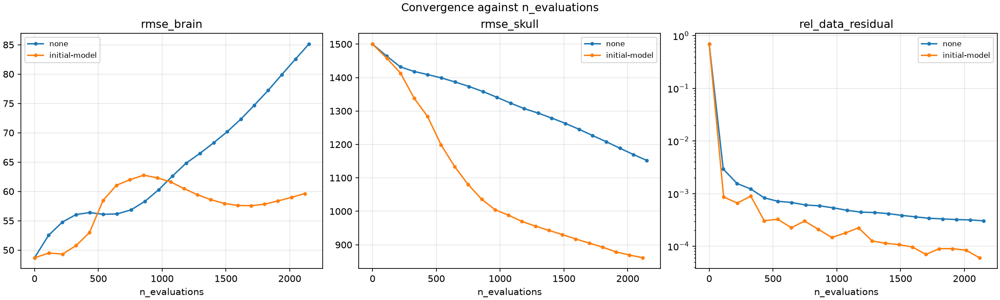
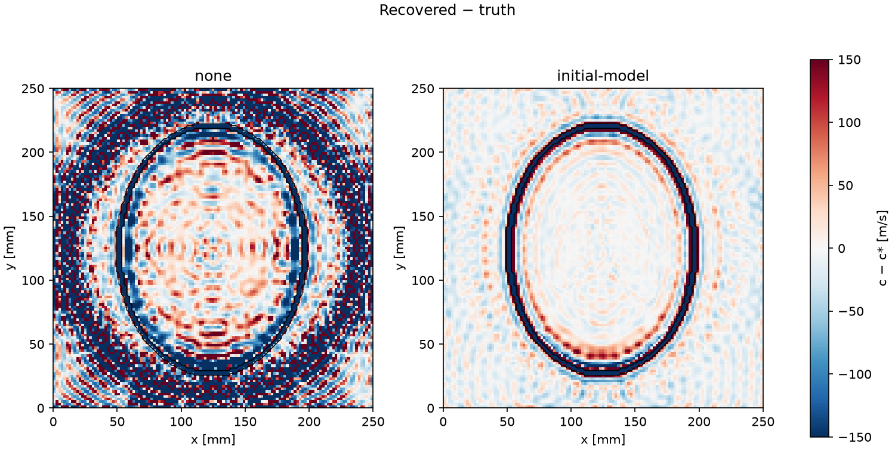

# 0002-wavefield-preconditioner: Does the wavefield preconditioner pay off in the joint solve?

## Question
Does the wavefield preconditioner lower the joint solve's wavefield and model error, and does it still win at equal wall time on the default problem's grid?

## Hypothesis
#96 found that, with the model frozen, `A(c₀)⁻¹` makes the wavefield block's iteration count flat in resolution: 17–38 iterations to a 1e-3 error, against 3639–8505 without it. The default problem's 125² interior is finer than any grid #96 measured. So the unpreconditioned wavefield block shouldn't converge within 100 × 20 iterations, while the preconditioned one should track the moving model.

Prediction: `initial_model`'s final `rel_wavefield_error` is at most **0.5×** `none`'s.

Cost (equal wall time): `initial_model` pays for its per-evaluation cost if, at its last tape row with `wall_s` ≤ `none`'s final `wall_s`, its `rel_wavefield_error` is also at most **0.5×** `none`'s final value. This is the one metric read from a non-final row. It comes from `tape.csv` (`log_every` = 5), not `summary.csv`.

Secondary effect sizes:
- `initial_model`'s final `rmse_skull` is at least **10% lower** than `none`'s.
- `initial_model`'s final `rmse_brain` is no more than **10% higher** than `none`'s.

Decision rule: the feature is kept (merged to `main` with default `none`, the "feature kept" PR) if the prediction and the cost criterion both hold. If the prediction holds but the cost criterion fails, the record says so and the user decides. If the prediction fails, #104 closes as `wontfix`, citing the record.

Also reported, with no effect size: `pde_rel_residual`, `rel_data_residual`, `bias_skull`, `bias_brain`, `ssim_brain`, `c_min`, `c_max`, `sat_frac`, `grad_u_norm`, `n_evaluations`, the run timings `warm_start_s` / `optimise_s` / `wavefield_solve_s`, the `rel_wavefield_error`-vs-`wall_s` curves of both arms, and the recovered − truth difference maps.

## Design
Variable: `optimiser.wavefield_preconditioner`. This is the feature under test from #104, on `exp/0002-wavefield-preconditioner`. Its default `none` keeps current behaviour (ADR-0001).
- `none` (default, Baseline): L-BFGS optimises `u_tilde = u / u_ref` directly.
- `initial_model`: L-BFGS optimises `v`, with `u_tilde = A(c₀)⁻¹ (|λ_tt| v)` per (shot, frequency), so `v` is in the PDE term's scale (ADR-0002). The band's warm-start `splu` factors are reused, and each evaluation costs one forward and one adjoint triangular solve on the CPU.

These are the only two values.

Baseline: #107's Baseline, i.e. the default config at `main` after #108 (`6540db3`), with the experiment branch rebased onto it. That is a 125² interior, PML 40 (a 205² grid), 64 transducers, `sigma_s` = 2.5 mm, a homogeneous 1500 m/s initial model, one 80 kHz band, `optimiser.model_preconditioner = none`, and `optimiser.n_iter = 100`. The `none` arm resolves to the same config as #107's 80 kHz arm, so the two results can be cross-checked.

Budget: both arms get the same `n_iter` = 100 outer × `inner_max_iter` = 20. One band, so no per-band schedule.

Fixed: phantom (`shepp_logan` truth, `homogeneous` init), grid, PML, acquisition, source (80 kHz 3-cycle Gaussian tone burst), `loss.weights` = `{pde: 1, data: 1, reg: 0}`, the per-(shot, frequency) RMS data weighting, and the L-BFGS settings (strong Wolfe, history 20). Both arms run sequentially on the same machine and device (`cpu`). Arms are compared at their final iterates, apart from the equal-wall-time reading above.

## Deviations from protocol

None. The Protocol body was last edited at 17:20:50Z, before the launch comment at 17:38:22Z.

## Assumptions and limitations
- **The model moves far from c₀.** #96 measured the preconditioner with c frozen about 8% from c₀. Here the skull starts at 1500 m/s, against a truth of up to about 3000 m/s. Where c departs from c₀, `A(c) A(c₀)⁻¹` is far from the identity, and the preconditioner's advantage may fade as the skull is recovered. The factors aren't refreshed within a band (#104, out of scope). A mid-run slowdown in the `initial_model` curve would be this effect.
- **The wall time is one machine's.** The `none` arm's cost is all torch, while the preconditioner's solves run in SciPy on the CPU. The equal-wall-time verdict holds for `cpu` on this machine. It doesn't carry over to a GPU, where only the preconditioner's solves would stay on the CPU, and it is exposed to background load.
- **Inverse crime, reg = 0, noise-free data.** The truth is a global minimiser in both arms. The comparison is of paths and of what each reaches within a fixed budget.
- **`model_preconditioner` stays `none`.** The `pde_diagonal` interaction (T changes by about A's column norms under the preconditioner) isn't tested here. See Chain.
- **One fixed budget.** A null result on the model columns at 100 × 20 doesn't rule out a later separation. #97 found the model barely moves without model preconditioning, so a wavefield gain may not carry through to `rmse_skull`.
- One phantom, one grid, one band, one source, no seeds.

## Context (from the Protocol)

- No records are banked yet (the index is empty). 0001-trace-weighting and 0002-model-preconditioner were voided (#46, #103), and their numbers were taken at the old default.
- #96 [findings](https://github.com/Commit2Cosmos/Transcranial-Ultrasound-ODIL/issues/96#issuecomment-6591741090): with the model frozen, the unpreconditioned wavefield block has κ ∝ h⁻⁴ plus PML outliers. `A(c₀)⁻¹` needs 38, 19 and 17 iterations to a 1e-3 wavefield error at three resolutions, against 3639–8505 for L-BFGS without it. Its caveat (c frozen near c₀, untested `pde_diagonal` interaction) is what this experiment and its Chain test.
- #104: the feature under test, on `exp/0002-wavefield-preconditioner`, rebased onto `main` (`8b383e3`): `94b0a75`, `b8dca7c`, plus `464763e` from this Protocol's probe. As first built, `v = A(c₀) ũ` carried A's units, so its PDE curvature was 1/λ_tt² ≈ 1e-10 smaller. In float32 the first L-BFGS step's decrease (3e-10) fell below the loss's resolution, and the arm never moved. `464763e` scales `v` by 1/|λ_tt|. After that, one outer step on the default problem cuts the loss to 7.8e-4 of its start in float32 and float64 alike, and the 3-iteration probe takes `rel_wavefield_error` from 0.78 to 0.45 (`none`: 0.74).
- #107 (Protocol, not launched): this experiment's Baseline is #107's Baseline arm.
- #97 (no model recovery without model preconditioning) and #98 (`pde_diagonal` plateau and drift): read into the model-column limitations.
- #99 (blocked by #104): its iteration budget depends on this record.

## Results

Final iterates (`summary.csv`), 100 outer × 20 inner iterations, cpu:

| label | is_baseline | status | `rel_wavefield_error` | `rmse_skull` [m/s] | `rmse_brain` [m/s] | `bias_skull` | `bias_brain` | `ssim_brain` | `rel_data_residual` | `pde_rel_residual` | `c_min` | `c_max` | `sat_frac` | `n_evaluations` | `wall_s` |
|---|---|---|---|---|---|---|---|---|---|---|---|---|---|---|---|
| none | true | completed | 0.4514 | 1152.0 | 85.10 | −1133.7 | −0.57 | 0.192 | 3.04e-4 | 9.77e-3 | 1300.2 | 3086.0 | 0.0041 | 2150 | 313.1 |
| initial-model | false | completed | **0.1024** | 861.1 | 59.63 | −851.2 | 11.97 | 0.558 | 6.04e-5 | 1.34e-3 | 1397.4 | 2582.8 | 0 | 2118 | 1027.8 |

Start row (Baseline `tape.csv`, `iter` = 0, the same in both runs): `rel_wavefield_error` 0.781, `rmse_skull` 1500.0, `rmse_brain` 48.69, `bias_skull` −1500.0, `ssim_brain` 0.695, `rel_data_residual` 0.694, `c_min` = `c_max` = 1500.

Ratios, initial-model / none: `rel_wavefield_error` **0.227**, `rmse_skull` 0.747 (−25.3%), `rmse_brain` 0.701 (−29.9%).

Equal wall time (the pre-registered reading): `initial_model`'s last tape row with `wall_s` ≤ 313.1 s (`none`'s final) is `iter` 25 at 263.1 s. There, `rel_wavefield_error` = 0.2425, i.e. **0.537×** `none`'s final 0.4514. The next row, `iter` 30 at 314.7 s (1.6 s past the cut), has 0.2214 (0.490×). At `iter` 25, `rmse_skull` is 1199.0 (`none` final: 1152.0) and `rmse_brain` 58.47 (`none` final: 85.10).

Timings (`band_summary.json`):

| label | `warm_start_s` | `optimise_s` | `wavefield_solve_s` | s per evaluation |
|---|---|---|---|---|
| none | 0.34 | 312.4 | 0 | 0.145 |
| initial-model | 0.34 | 1027.4 | 737.1 (72% of `optimise_s`) | 0.485 |

Health warnings: `none` hit `c_min` within 1% of 1300 m/s from `iter` 5 and `c_max` within 1% of 3100 m/s from `iter` 55. `initial_model` raised none.

## Conclusions supported

- **At equal outer budget, the preconditioner cuts the final wavefield error to 0.23× of the Baseline's** (`rel_wavefield_error` 0.1024 against 0.4514). This meets the prediction (≤ 0.5×). Both arms used about the same number of evaluations (2118 against 2150).
- **It carries through to the skull:** final `rmse_skull` is 25.3% lower (861.1 against 1152.0 m/s; the effect size was ≥ 10%). The convergence figure shows the gap opening from about 300 evaluations on.
- **It doesn't cost the brain:** final `rmse_brain` is 29.9% *lower* (59.63 against 85.10 m/s), well inside the "no more than 10% higher" bound.
- **At equal wall time it falls just short of the pre-registered cost criterion:** 0.537× at the last row within `none`'s wall time, against a threshold of 0.5×. So the decision rule's "prediction holds, cost fails" branch applies, and keeping the feature is the user's call. The margin is one log interval: 1.6 s later, at `iter` 30, the ratio is 0.490×.
- **One evaluation costs 3.3× as much with the preconditioner** (0.485 against 0.145 s), and the triangular solves take 72% of the optimisation time (`wavefield_solve_s` 737 of 1027 s).
- **The preconditioner keeps the model inside the speed bounds:** `sat_frac` 0 and `c` in [1397, 2583] m/s. `none` pins cells at both bounds (`sat_frac` 0.0041, `c_min` 1300.2, `c_max` 3086). Its difference map shows strong ±150 m/s ring artefacts in the water outside the skull, which are largely absent with the preconditioner.

## Conclusions not supported

- **"The preconditioner pays at equal wall time."** By the pre-registered reading it doesn't (0.537×). The reading sits on a knife-edge at the `log_every` granularity, and with one run per arm there's no estimate of wall-time noise, so "it doesn't pay" isn't supported either. The cost question is open on this machine.
- **"The preconditioner recovers the skull."** Neither arm comes close: `bias_skull` is still −851 m/s against a truth of about 3000 m/s, and the skull rim in both difference maps is still dark (at the colour scale's −150 m/s limit).
- **"It improves the brain over the start."** Both arms end worse than the start row's `rmse_brain` (48.69 m/s) and `ssim_brain` (0.695). The preconditioner only loses less.
- Anything about GPU wall time, other grids or bands, or `pde_diagonal` together with the preconditioner (see Assumptions and limitations).

## Surprises

- **The equal-wall-time comparison is decided by the log grid.** With `log_every` = 5 and about 10.3 s per outer iteration, the reading jumps from 0.537× (`iter` 25) to 0.490× (`iter` 30) across the cut. A cost comparison at equal wall time needs either finer logging or a longer gap between arms. *Fix:* set `optimiser.log_every` = 1 when wall time is a criterion.
- **Cost per evaluation is far above #96's.** #96 measured the preconditioned frozen-model solve as faster in wall time than plain L-BFGS at every resolution, because it needed 100× fewer iterations. In the joint solve the iteration count doesn't fall (the evaluations are about equal), so the 3.3× per-evaluation cost is paid in full. *Likely cause:* the model block, not the wavefield block, sets the pace once the preconditioner is on. The wavefield error falls steadily rather than converging in tens of iterations. *Possible fix:* cheaper solves (one `lu.solve` call per frequency is already batched over shots; the factors are complex64 in float32, so the cost is SuperLU's triangular sweep itself) or fewer evaluations through the model preconditioner (Chain link 2).
- **Without the preconditioner the brain gets steadily worse** (48.7 → 85.1 m/s, `ssim_brain` 0.695 → 0.192), while the data residual is already at 3e-4. L-BFGS fits the data with a wavefield that violates the PDE (`rel_wavefield_error` still 0.45), and the model absorbs the mismatch as artefacts in the water and at the bounds. With the preconditioner, `rmse_brain` peaks at 62.8 m/s near 850 evaluations and then recovers.
- The float32 stall found while probing (`464763e`, see Context) was a scaling bug in the feature, not a precision limit.

## Follow-ups

- **Chain link 2 (from the Protocol): model preconditioner under the wavefield preconditioner.** `optimiser.model_preconditioner` ∈ {none, pde_diagonal}. Proposed Baseline: this record's `initial_model` arm (the default config at `main` with `optimiser.n_iter` = 100, `optimiser.wavefield_preconditioner` = `initial_model`), if the feature is kept.
- **Budget:** the skull is still far from recovered in both arms and falling steadily. #99's budget question should take this record's numbers into account. Proposed Baseline: this record's `initial_model` arm.

## Validity

Current.
